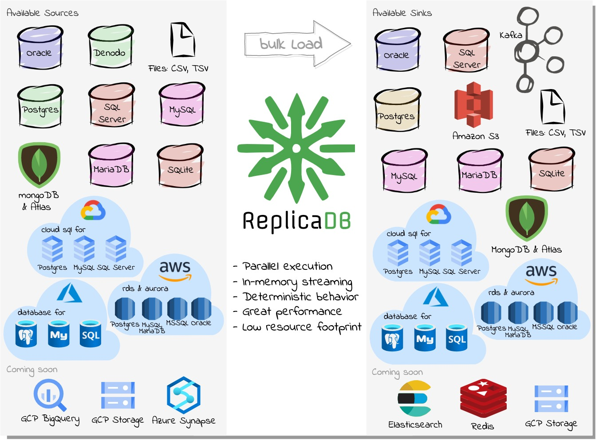
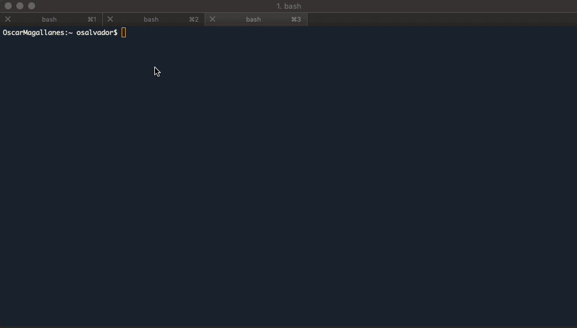
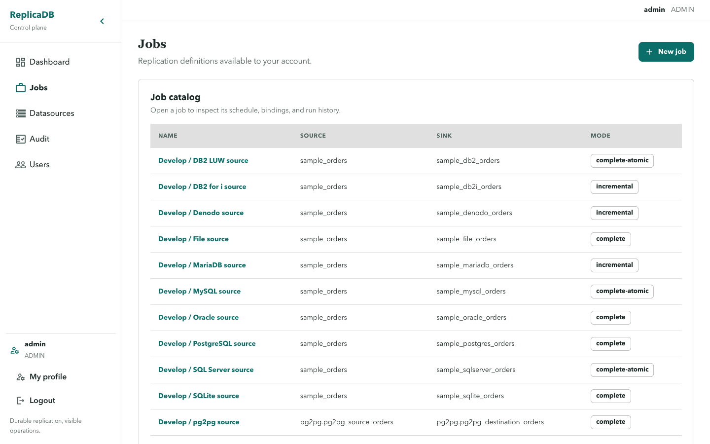
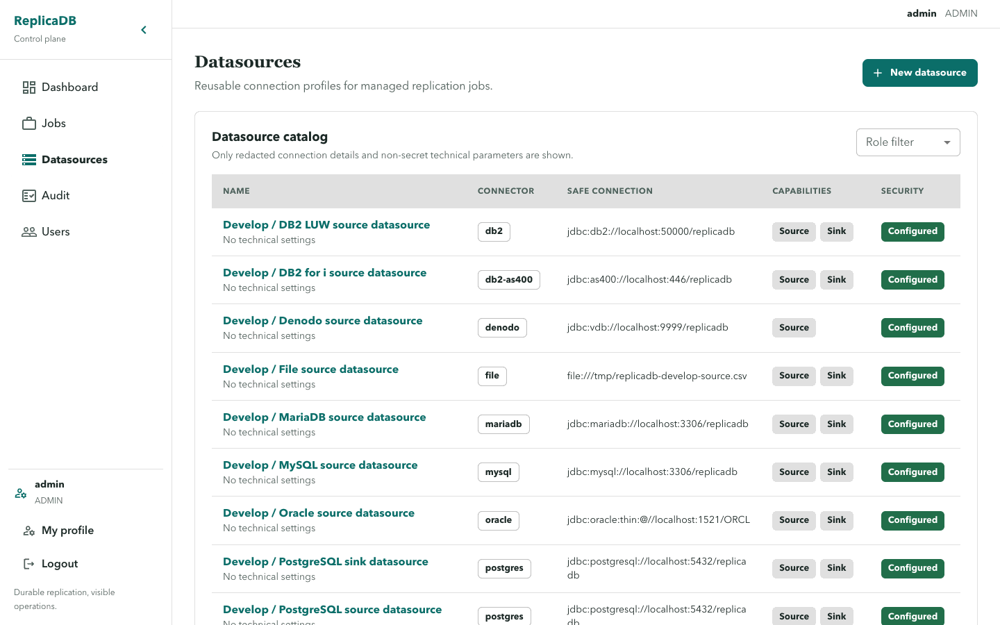
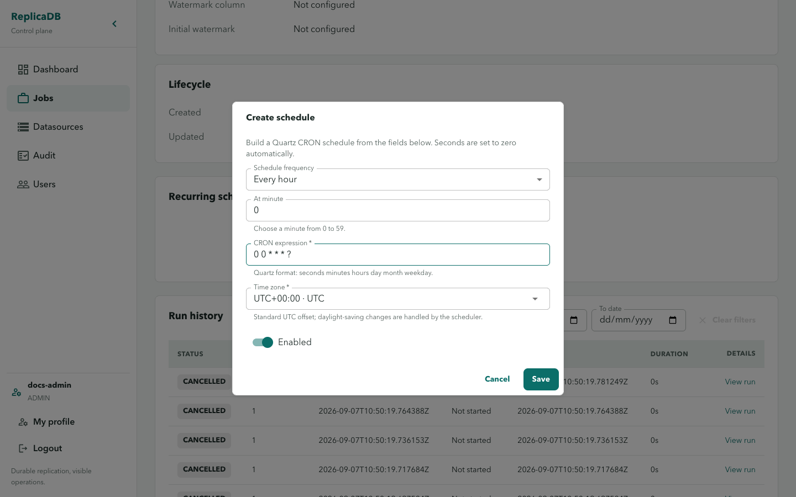

# ReplicaDB

<p align="center">
  <a href="https://osalvador.github.io/ReplicaDB/">
    
  </a>
</p>

[](https://github.com/osalvador/ReplicaDB/releases/latest)
[](LICENSE)
[](https://hub.docker.com/r/osalvador/replicadb)
[](https://github.com/osalvador/ReplicaDB/releases)
[](https://github.com/osalvador/ReplicaDB/stargazers)
[](https://bestpractices.coreinfrastructure.org/projects/4190)

**Copy data in batches between databases and other data stores.** Use
ReplicaDB to migrate an Oracle table to PostgreSQL, refresh a reporting table,
or export selected rows to CSV. ReplicaDB can split large transfers into
parallel tasks where the connectors support it. It runs without installing
agents or triggers on the source database.

[Documentation](https://osalvador.github.io/ReplicaDB/) ·
[CLI quickstart](https://osalvador.github.io/ReplicaDB/getting-started/cli-quickstart/) ·
[Server quickstart](https://osalvador.github.io/ReplicaDB/getting-started/server-quickstart/) ·
[Server screenshots](#replicadb-server-in-action) ·
[Connector matrix](https://osalvador.github.io/ReplicaDB/connectors/) ·
[Configuration wizard](https://osalvador.github.io/ReplicaDB/wizard/index.html)

<p align="center">
  <a href="docs/src/assets/media/ReplicaDB-Conceptual.jpg">
    
  </a>
</p>

The illustration shows the source-to-destination flow. The
[connector matrix](https://osalvador.github.io/ReplicaDB/connectors/) lists current support.

## Choose CLI or Server

| If you want to… | Start here |
| --- | --- |
| Run a transfer from a terminal, script, or existing scheduler | **CLI** · Run a standalone command or save a reusable options file. [CLI quickstart](https://osalvador.github.io/ReplicaDB/getting-started/cli-quickstart/) |
| Manage recurring transfers with a team | **Server** · Configure jobs in the web UI or API, schedule runs, manage access, and inspect run history. [Server quickstart](https://osalvador.github.io/ReplicaDB/getting-started/server-quickstart/) |

Both use the same replication engine. The two quickstarts use the same
PostgreSQL sample data so you can try either workflow.

## Key features

- **Replicate across different systems.** Move data between relational
  databases and MongoDB, or export rows to CSV, ORC, S3, or Kafka. Supported
  directions and modes vary by connector. [Connector matrix](https://osalvador.github.io/ReplicaDB/connectors/)
- **Parallel bulk transfers.** Split source reads across workers where
  supported and use native loaders such as PostgreSQL COPY and SQL Server
  bulk copy. [Parallelism and tuning](https://osalvador.github.io/ReplicaDB/cli/parallelism/)
- **Control how the destination changes.** Refresh it in place, stage a full
  replacement for an atomic publish, or load an incremental batch. A filter
  or a source watermark can bound what the run reads. [Replication modes](https://osalvador.github.io/ReplicaDB/cli/replication-modes/)
- **Define the transfer in an options file.** Select columns, filter rows,
  use a custom source query where supported, or list several table pairs for
  one sequential CLI run. [Configuration wizard](https://osalvador.github.io/ReplicaDB/wizard/index.html)
- **Operate recurring jobs in Server.** Reuse connection profiles with
  encrypted credentials, manage access to jobs and datasources, and inspect
  run history and diagnostics from the web UI or API. [Server guide](https://osalvador.github.io/ReplicaDB/server/)

## Try a local transfer

Copy a single order from SQLite to CSV. You need Java 17 or newer and
`sqlite3`. Run this in a POSIX shell. It creates a fresh directory for the
database and output file.

```bash
demo_dir=$(mktemp -d /tmp/replicadb-demo.XXXXXX)
cd "$demo_dir"

curl -fLO https://github.com/osalvador/ReplicaDB/releases/download/v1.0.3/ReplicaDB-1.0.3.tar.gz
tar -xzf ReplicaDB-1.0.3.tar.gz

sqlite3 orders.db "CREATE TABLE orders (id INTEGER PRIMARY KEY, status TEXT);
INSERT INTO orders VALUES (1, 'pending');"

cat > orders.conf <<'EOF'
mode=complete
jobs=1
source.connect=jdbc:sqlite:orders.db
source.table=orders
sink.connect=file://${PWD}/orders.csv
sink.file.format=csv
sink.connect.parameter.format.firstRecordAsHeader=true
EOF

./bin/replicadb --options-file orders.conf
cat orders.csv
```

Expected output:

```csv
id,status
1,pending
```

For a database-to-database transfer, follow the
[PostgreSQL walkthrough](https://osalvador.github.io/ReplicaDB/getting-started/cli-quickstart/).
Use the [options-file guide](https://osalvador.github.io/ReplicaDB/cli/configuration/)
to save a repeatable transfer. For Windows packages or the full installation
options, see [Releases](https://github.com/osalvador/ReplicaDB/releases/latest),
[CLI installation](https://osalvador.github.io/ReplicaDB/cli/installation/),
or [Server installation](https://osalvador.github.io/ReplicaDB/server/installation/).
The [CLI container image](https://hub.docker.com/r/osalvador/replicadb) is also
available for Docker and Podman. For SELinux volume mounts, see
[Podman volume options](https://docs.podman.io/en/latest/markdown/podman-run.1.html#volume-v-source-volume-host-dir-options).

<details>
<summary>Watch an Oracle-to-PostgreSQL CLI transfer</summary>



</details>

## ReplicaDB Server in action

Create a job from reusable connections, choose a replication mode, and run it
on demand or on a schedule. The job's run history gives you the result,
row counts and [diagnostics](https://osalvador.github.io/ReplicaDB/server/runs-and-diagnostics/).

[](docs/src/assets/screenshots/server/jobs.png)

<table>
  <thead>
    <tr>
      <th><a href="https://osalvador.github.io/ReplicaDB/server/datasources/">Reuse connection profiles</a></th>
      <th><a href="https://osalvador.github.io/ReplicaDB/server/schedules/">Schedule recurring transfers</a></th>
    </tr>
  </thead>
  <tbody>
    <tr>
      <td><a href="docs/src/assets/screenshots/server/datasources.png"></a></td>
      <td><a href="docs/src/assets/screenshots/server/schedule.png"></a></td>
    </tr>
  </tbody>
</table>

Start the [Server quickstart](https://osalvador.github.io/ReplicaDB/getting-started/server-quickstart/)
to configure the connections and run your first managed job.

## Choose how to write to the destination

| Mode | What it does |
| --- | --- |
| `complete` | Replaces the destination by default. An interrupted run can leave a database destination empty or partially loaded. |
| `complete-atomic` | Loads a staging table before publishing the replacement. The destination connector determines the transaction guarantees. |
| `incremental` | Writes a selected set of new or changed rows. Supported database sinks merge by key, while file sinks append. |

See [replication modes](https://osalvador.github.io/ReplicaDB/cli/replication-modes/)
for what readers see during a run, how watermarks advance, and how to recover
from an interruption. See [incremental watermarks](https://osalvador.github.io/ReplicaDB/cli/incremental-watermarks/)
to configure a bounded read.

## Compatible databases

Connectors cover Oracle, PostgreSQL, MySQL, MariaDB, SQL Server, Db2, SQLite,
MongoDB, Denodo, CSV, Amazon S3, Kafka, and generic JDBC. Source and destination
roles, modes, and staging support vary by connector. Check the
[connector matrix](https://osalvador.github.io/ReplicaDB/connectors/) before
choosing a pair. See the [Db2 connector guide](https://osalvador.github.io/ReplicaDB/connectors/db2/)
for platform and driver details and the
[generic JDBC guide](https://osalvador.github.io/ReplicaDB/connectors/generic-jdbc/)
to configure an external driver.

## Documentation

- [Configuration wizard](https://osalvador.github.io/ReplicaDB/wizard/index.html) to build a CLI options file.
- [Filtering and queries](https://osalvador.github.io/ReplicaDB/cli/filtering-and-queries/) and [multi-table replication](https://osalvador.github.io/ReplicaDB/cli/multi-table/) to select what a transfer copies.
- [Server development](replicadb-server/README.md) and [distributed deployment](DEPLOYMENT.md) for repository setup and deployment details.
- [Server operations](https://osalvador.github.io/ReplicaDB/operations/) and the [Server API](https://osalvador.github.io/ReplicaDB/api-introduction/) to deploy, operate, and automate managed jobs.

See the [documentation portal](https://osalvador.github.io/ReplicaDB/) for the
complete guides.

## Roadmap

See [ROADMAP.md](ROADMAP.md) for planned capabilities and product decisions.

## Contributing

See [CONTRIBUTING.md](CONTRIBUTING.md) for build and test instructions.
Use [GitHub Issues](https://github.com/osalvador/ReplicaDB/issues) to report a
bug or propose a feature.

## License

ReplicaDB is available under the [Apache License 2.0](LICENSE).
